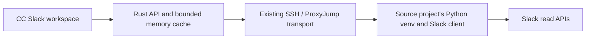

import { test, expect } from '@playwright/test';
import { mkdtempSync, mkdirSync, writeFileSync, readFileSync, rmSync, existsSync, copyFileSync, symlinkSync } from 'node:fs';
import { tmpdir, userInfo } from 'node:os';
import { join, resolve } from 'node:path';
import { spawn, spawnSync, type ChildProcess } from 'node:child_process';
import { createServer } from 'node:net';
let dir: string, socket: string, backend: ChildProcess, sshd: ChildProcess | undefined, base: string, pane: string, window: string, session: string, home: string;
function command(program: string, args: string[]) { const r = spawnSync(program, args, { encoding:'utf8', env:{...process.env, TMUX:''} }); if(r.status!==0) throw Error(r.stderr); return r.stdout.trim(); }
function tmux(...args:string[]) { return command('tmux',['-S',socket,...args]); }
async function port() { return new Promise<number>(r=>{ const s=createServer(); s.listen(0,'127.0.0.1',()=>{const p=(s.address() as {port:number}).port;s.close(()=>r(p));});}); }
function agentCommand() { return `printf '› \\n'; exec env CODEX_HOME=${home} ${join(dir,'codex')}`; }
function resetAgent() { tmux('respawn-pane','-k','-t',pane,'-c',dir,agentCommand()); }
test.beforeAll(async()=>{
  dir=mkdtempSync(join(tmpdir(),'cc-agents-')); socket=join(dir,'tmux.sock');home=join(dir,'codex-home');
  copyFileSync('/bin/cat',join(dir,'codex'));
  const sessions=join(home,'sessions','2026','10','31');mkdirSync(sessions,{recursive:true});
  const records: object[]=[{type:'session_meta',payload:{id:'aaaaaaaa-aaaa-aaaa-aaaa-aaaaaaaaaaaa',cwd:dir,timestamp:'2026-10-31T12:00:00Z'}}];
  for(let i=0;i<125;i++) records.push({type:'response_item',timestamp:'2026-10-31T12:00:00Z',payload:{type:'message',role:i%2?'assistant':'user',content:[{type:'output_text',text:`Conversation message ${i}${i===124?' ':''}`}]}});
  records.push({type:'response_item',payload:{type:'reasoning',content:[{type:'text',text:'HIDDEN_REASONING'}]}});
  writeFileSync(join(sessions,'rollout-test.jsonl'),records.map(r=>JSON.stringify(r)).join('\n')+'\n');
  tmux('-f','/dev/null','new-session','-d','-s','agents','-n','active','-c',dir,'-x','100','-y','35',agentCommand());
  pane=tmux('display-message','-p','-t','agents','#{pane_id}');window=tmux('display-message','-p','-t','agents','#{window_id}');session=tmux('display-message','-p','-t','agents','#{session_id}');
  let remote='';
  if(existsSync('/usr/sbin/sshd')) {
    command('ssh-keygen',['-q','-t','ed25519','-N','','-f',join(dir,'hostkey')]);command('ssh-keygen',['-q','-t','ed25519','-N','','-f',join(dir,'identity')]);
    writeFileSync(join(dir,'authorized_keys'),readFileSync(join(dir,'identity.pub')),{mode:0o600});const sshPort=await port();
    writeFileSync(join(dir,'sshd_config'),`Port ${sshPort}\nListenAddress 127.0.0.1\nHostKey ${dir}/hostkey\nAuthorizedKeysFile ${dir}/authorized_keys\nStrictModes no\nPasswordAuthentication no\nKbdInteractiveAuthentication no\nUsePAM no\nPidFile ${dir}/sshd.pid\nAllowUsers ${userInfo().username}\nLogLevel ERROR\n`);
    sshd=spawn('/usr/sbin/sshd',['-D','-e','-f',join(dir,'sshd_config')],{stdio:'pipe'});
    writeFileSync(join(dir,'known_hosts'),`[127.0.0.1]:${sshPort} ${readFileSync(join(dir,'hostkey.pub'),'utf8')}`);
    writeFileSync(join(dir,'ssh_config'),`Host agent-fixture\n HostName 127.0.0.1\n Port ${sshPort}\n User ${userInfo().username}\n IdentityFile ${dir}/identity\n IdentitiesOnly yes\n UserKnownHostsFile ${dir}/known_hosts\n`);
    remote=`\n[[hosts]]\nid="remote"\nname="Remote agents"\nsocket=${JSON.stringify(socket)}\nssh="agent-fixture"\nssh_config=${JSON.stringify(join(dir,'ssh_config'))}\n`;
  }
  const backendPort=await port();base=`http://127.0.0.1:${backendPort}`;
  writeFileSync(join(dir,'config'),`[[hosts]]\nid="local"\nname="Local agents"\nsocket=${JSON.stringify(socket)}\n${remote}`);
  backend=spawn(resolve(process.env.CC_BINARY||'../target/debug/command-center'),['--listen',`127.0.0.1:${backendPort}`,'--config',join(dir,'config'),'--web-dir',resolve(process.env.CC_WEB_DIR||'dist')],{stdio:'pipe'});
  await expect.poll(async()=>{try{return(await fetch(`${base}/api/v1/health`)).status;}catch{return 0;}}).toBe(200);
  await expect.poll(()=>tmux('display-message','-p','-t',pane,'#{pane_current_command}')).toBe('codex');
});
test.afterAll(()=>{backend?.kill('SIGTERM');sshd?.kill('SIGTERM');if(socket)spawnSync('tmux',['-S',socket,'kill-server']);if(dir)rmSync(dir,{recursive:true,force:true});});
async function detail(host='local', extra: Record<string,string>={}) {
  const hosts=await(await fetch(`${base}/api/v1/hosts`)).json();
  const query=new URLSearchParams({session,window,pane,connection_revision:hosts.find((h:{id:string})=>h.id===host).connection_revision,...extra});
  const r=await fetch(`${base}/api/v1/hosts/${host}/agents/conversation?${query}`);expect(r.status).toBe(200);return r.json();
}
async function send(token:string,text:string,host='local') { return fetch(`${base}/api/v1/hosts/${host}/agents/message`,{method:'POST',headers:{Origin:base,'Content-Type':'application/json'},body:JSON.stringify({token,text})}); }

test('live agents, native history, pagination, draft preservation, and narrow-screen navigation',async({page})=>{
  const errors:string[]=[];page.on('pageerror',e=>errors.push(e.message));
  await page.goto(base);await page.locator('#show-queue').click();
  await expect(page.locator('.queue-card').first()).toContainText('Unknown');
  await expect(page.locator('#queue-count')).toHaveText('0');
  await expect(page.getByLabel('Conversation history',{exact:true}).locator('option')).toHaveCount(2);
  const select=page.getByLabel('Conversation history',{exact:true});const value=await select.locator('option').nth(1).getAttribute('value');await expect(select).toHaveValue(value!);
  await expect(page.getByLabel('Conversation messages')).toContainText('Conversation message 124');
  await expect(page.getByLabel('Conversation messages')).not.toContainText('HIDDEN_REASONING');
  await expect(page.getByLabel('Conversation messages').locator('img')).toHaveCount(0);
  await expect(page.getByLabel('Conversation messages').locator('article')).toHaveCount(100);
  await page.screenshot({path:'../test-results/live-agents-desktop.png'});
  await page.getByRole('button',{name:'Load older messages'}).click();await expect(page.getByLabel('Conversation messages')).toContainText('Conversation message 0');
  const composer=page.getByRole('textbox',{name:'Message to agent'});await composer.fill('retained draft');
  await page.getByRole('button',{name:'Refresh queue',exact:true}).click();await expect(composer).toHaveValue('retained draft');
  await page.setViewportSize({width:390,height:844});await page.locator('.queue-card').first().click();await expect(composer).toBeVisible();
  expect(await page.evaluate(()=>document.documentElement.scrollWidth<=innerWidth)).toBe(true);
  const composerBounds=await composer.boundingBox();expect(composerBounds!.y+composerBounds!.height).toBeLessThanOrEqual(844);
  await page.screenshot({path:'../test-results/live-agents-compact.png'});
  await page.getByRole('button',{name:'← Agents',exact:true}).click();await expect(page.locator('.queue-card').first()).toBeVisible();
  await page.locator('.queue-card').first().click();
  await composer.fill('CC_BROWSER_AGENT_MESSAGE');
  await expect(page.getByRole('button',{name:'Send message',exact:true})).toBeEnabled();
  await page.getByRole('button',{name:'Send message',exact:true}).click();
  await expect(composer).toHaveValue('');
  await expect.poll(()=>tmux('capture-pane','-p','-t',pane)).toContain('CC_BROWSER_AGENT_MESSAGE');
  // An uncertain network response preserves the draft and requires explicit review.
  await page.route('**/agents/message',route=>route.fulfill({status:502,json:{error:'Fixture delivery uncertain'}}));
  await composer.fill('Keep this uncertain draft');
  await expect(page.getByRole('button',{name:'Send message',exact:true})).toBeEnabled();
  await page.getByRole('button',{name:'Send message',exact:true}).click();
  await expect(composer).toHaveValue('Keep this uncertain draft');
  await expect(page.getByRole('button',{name:'Send message',exact:true})).toBeDisabled();
  await expect(page.getByRole('button',{name:'I’ve checked delivery',exact:true})).toBeVisible();
  expect(errors).toEqual([]);
});

test('messages target the current process, reject replay and stale screens, and work over SSH',async()=>{
  resetAgent();await expect.poll(()=>tmux('display-message','-p','-t',pane,'#{pane_current_command}')).toBe('codex');
  const first=await detail();expect(first.instance).toBeTruthy();expect(first.message_token).toBeTruthy();
  const sent=await send(first.message_token,'CC_AGENT_MESSAGE café');expect(sent.status).toBe(200);
  await expect.poll(()=>tmux('capture-pane','-p','-t',pane)).toContain('CC_AGENT_MESSAGE café');
  expect((await send(first.message_token,'DUPLICATE_SHOULD_NOT_SEND')).status).toBe(410);
  expect(tmux('capture-pane','-p','-t',pane)).not.toContain('DUPLICATE_SHOULD_NOT_SEND');
  const log=first.conversations[0]; const history=await detail('local',{conversation:log.id});
  const unchanged=await detail('local',{conversation:log.id,known_version:history.history_version});
  expect(unchanged.history_unchanged).toBe(true);expect(unchanged.messages).toHaveLength(0);
  const stale=await detail();tmux('send-keys','-t',pane,'-l','external input');
  await expect.poll(()=>tmux('capture-pane','-p','-t',pane)).toContain('external input');
  expect((await send(stale.message_token,'STALE_SCREEN')).status).toBe(409);
  const replaced=await detail();resetAgent();await expect.poll(async()=> (await detail()).instance).not.toBe(replaced.instance);
  expect((await send(replaced.message_token,'WRONG_PROCESS')).status).toBe(409);
  expect(tmux('capture-pane','-p','-t',pane)).not.toContain('WRONG_PROCESS');
  if(sshd) {const remote=await detail('remote');expect(remote.conversations.length).toBe(1);expect((await send(remote.message_token,'CC_REMOTE_AGENT','remote')).status).toBe(200);await expect.poll(()=>tmux('capture-pane','-p','-t',pane)).toContain('CC_REMOTE_AGENT');}
  const old=await detail(); const settings=await(await fetch(`${base}/api/v1/settings/hosts`)).json();
  const alias=join(dir,'alias.sock');symlinkSync(socket,alias);
  const edit=await fetch(`${base}/api/v1/hosts/local`,{method:'PUT',headers:{Origin:base,'Content-Type':'application/json'},body:JSON.stringify({revision:settings.revision,host:{name:'Local agents',socket:alias,ssh:null,ssh_config:null}})});
  expect(edit.status).toBe(200);expect((await send(old.message_token,'WRONG_ENDPOINT')).status).toBe(409);
  expect(tmux('capture-pane','-p','-t',pane)).not.toContain('WRONG_ENDPOINT');
  tmux('send-keys','-t',pane,'-l','Would you like to run this command?\n1. Yes\n2. No\nEsc to cancel\n');
  await expect.poll(async()=> (await detail()).attention).toBe(true);
  const approval=await detail();expect(approval.send_available).toBe(false);expect(approval.message_token).toBeUndefined();
});

test('provider status transitions update filters and disconnected agents remain visible', async ({page}) => {
  test.setTimeout(60000);
  copyFileSync('/bin/cat',join(dir,'claude'));
  const providerHome=join(dir,'claude-home');mkdirSync(join(providerHome,'sessions'),{recursive:true});
  const providerPane=tmux('new-window','-d','-P','-F','#{pane_id}','-t','agents','-n','provider','-c',dir,`exec env CLAUDE_CONFIG_DIR=${providerHome} ${join(dir,'claude')}`);
  await expect.poll(()=>tmux('display-message','-p','-t',providerPane,'#{pane_current_command}')).toBe('claude');
  const pid=tmux('display-message','-p','-t',providerPane,'#{pane_pid}');
  const providerWindow=tmux('display-message','-p','-t',providerPane,'#{window_id}');
  const raw=readFileSync(`/proc/${pid}/stat`,'utf8');const start=raw.slice(raw.lastIndexOf(')')+2).trim().split(/\s+/)[19];
  const started=Date.now()-1000;
  function status(value:string) {const now=Date.now();writeFileSync(join(providerHome,'sessions',`${pid}.json`),JSON.stringify({pid:Number(pid),procStart:start,sessionId:'cccccccc-cccc-cccc-cccc-cccccccccccc',tmux:`${session.slice(1)}:${providerWindow}.${providerPane}`,cwd:dir,startedAt:started,status:value,statusUpdatedAt:now,updatedAt:now}));}
  async function observed() {const data=await(await fetch(`${base}/api/v1/queue`)).json();return data.hosts.find((h:{id:string})=>h.id==='local').items.find((i:{pane:string})=>i.pane===providerPane);}
  status('idle');
  await expect.poll(async()=> (await observed())?.activity.state,{timeout:15000}).toBe('ready');
  await page.goto(base);await page.locator('#show-queue').click();
  await page.getByLabel('Queue machine',{exact:true}).selectOption('local');
  const filter=page.getByLabel('Agent status',{exact:true});await filter.selectOption('ready');
  await expect(page.locator('.queue-card')).toHaveCount(1);await expect(page.locator('.queue-card')).toContainText('Ready');
  await filter.selectOption('');
  status('working');await expect.poll(async()=> (await observed())?.activity.state,{timeout:15000}).toBe('working');
  await page.getByRole('button',{name:'Refresh queue',exact:true}).click();await filter.selectOption('working');
  await expect(page.locator('.queue-card')).toHaveCount(1);await expect(page.locator('.queue-card')).toContainText('Working');
  status('idle');await expect.poll(async()=> (await observed())?.activity.state,{timeout:15000}).toBe('ready');
  expect((await observed()).attention.finished).toBe(true);
  status('waiting_for_approval');await expect.poll(async()=> (await observed())?.activity.state,{timeout:15000}).toBe('approval');
  await filter.selectOption('');await page.getByRole('button',{name:'Refresh queue',exact:true}).click();
  const providerCard=page.locator('.queue-card').filter({hasText:'provider'});await expect(providerCard).toContainText('Awaiting approval');await providerCard.click();
  await expect(page.getByRole('button',{name:'Send message',exact:true})).toBeDisabled();
  // Replacing the process leaves a briefly retained card, never a false Ready.
  tmux('respawn-pane','-k','-t',providerPane,'exec /bin/cat');
  await expect.poll(async()=> (await observed())?.activity.state,{timeout:15000}).toBe('disconnected');
  await page.getByRole('button',{name:'Refresh queue',exact:true}).click();await filter.selectOption('disconnected');
  await expect(page.locator('.queue-card')).toHaveCount(1);await expect(page.locator('.queue-card')).toContainText('Disconnected');
  await expect(page.getByRole('button',{name:'Send message',exact:true})).toBeDisabled();
  await page.route('**/api/v1/queue',route=>route.abort());
  await page.getByRole('button',{name:'Refresh queue',exact:true}).click();
  await expect(page.locator('#queue-count')).toHaveText('?');
  await expect(page.locator('.queue-card')).toHaveCount(2);
  await expect(page.locator('.queue-card .agent-state')).toHaveText(['Disconnected','Disconnected']);
  await expect(page.getByRole('button',{name:'Send message',exact:true})).toBeDisabled();
  await page.unroute('**/api/v1/queue');await page.getByRole('button',{name:'Refresh queue',exact:true}).click();
  await expect(page.locator('.queue-card')).toHaveCount(1);
  tmux('set-option','-w','-t',window,'remain-on-exit','on');tmux('send-keys','-t',pane,'C-c');
  await expect.poll(()=>tmux('display-message','-p','-t',pane,'#{pane_dead}')).toBe('1');
  await expect.poll(async()=> {const data=await(await fetch(`${base}/api/v1/queue`)).json();return data.hosts.find((h:{id:string})=>h.id==='local').items.find((i:{pane:string})=>i.pane===pane)?.activity.state;},{timeout:15000}).toBe('disconnected');
  await page.getByRole('button',{name:'Refresh queue',exact:true}).click();
  await page.locator('.queue-card').filter({hasText:'active'}).click();
  await expect(page.getByRole('button',{name:'Mark read',exact:true})).toBeVisible();
  await page.getByRole('button',{name:'Mark read',exact:true}).click();
  await expect(page.getByRole('button',{name:'Mark read',exact:true})).toBeHidden();
  await expect(page.getByRole('button',{name:'Send message',exact:true})).toBeDisabled();
});

test('new replies need attention until explicitly opened, and read state survives backend restart', async ({page,browser}) => {
  test.setTimeout(60000);
  const project=join(dir,'attention-project'),providerHome=join(dir,'attention-home'),logs=join(providerHome,'sessions/2026/10/31');
  mkdirSync(project);mkdirSync(logs,{recursive:true});
  const log=join(logs,'rollout-attention.jsonl');
  const assistant=(text:string)=>({type:'response_item',timestamp:new Date().toISOString(),payload:{type:'message',role:'assistant',content:[{type:'output_text',text}]}});
  writeFileSync(log,JSON.stringify({type:'session_meta',payload:{id:'dddddddd-dddd-dddd-dddd-dddddddddddd',cwd:project}})+'\n'+Array.from({length:110},(_,i)=>JSON.stringify(assistant(`Already existing history ${i}`))).join('\n')+'\n');
  const target=tmux('new-window','-d','-P','-F','#{pane_id}','-t','agents','-n','attention-test','-c',project,`exec env CODEX_HOME=${providerHome} ${join(dir,'codex')}`);
  await expect.poll(()=>tmux('display-message','-p','-t',target,'#{pane_current_command}')).toBe('codex');
  async function item() {const data=await(await fetch(`${base}/api/v1/queue`)).json();return data.hosts.find((h:{id:string})=>h.id==='local').items.find((i:{pane:string})=>i.pane===target);}
  await expect.poll(async()=>!!await item(),{timeout:15000}).toBe(true);
  expect((await item()).attention.unread_reply).toBe(false);
  await page.goto(base);
  writeFileSync(log,readFileSync(log,'utf8')+JSON.stringify(assistant('A new unread reply'))+'\n');
  await expect.poll(async()=> (await item()).attention.unread_reply,{timeout:15000}).toBe(true);
  await page.setViewportSize({width:390,height:844});
  await page.locator('#show-queue').click();await page.locator('.queue-filter-panel>summary').click();await page.getByLabel('Queue machine',{exact:true}).selectOption('local');
  await page.getByLabel('Agent status',{exact:true}).selectOption('needs_attention');
  await page.getByRole('button',{name:'Done',exact:true}).click();
  const card=page.locator('.queue-card').filter({hasText:'attention-test'});await expect(card).toContainText('Unread reply');
  // Automatic previews must not clear unread badges or drain the filter.
  expect((await item()).attention.unread_reply).toBe(true);
  await page.screenshot({path:'../test-results/attention-unread-desktop.png'});
  await card.click();await expect(page.getByLabel('Conversation messages')).toContainText('A new unread reply');
  await expect.poll(async()=> (await item()).attention.unread_reply).toBe(false);
  await expect(page.getByLabel('Conversation messages').getByText('A new unread reply',{exact:true})).toBeInViewport();
  await page.screenshot({path:'../test-results/attention-unread-compact.png'});
  await expect(card).toHaveCount(0);
  await expect(page.getByLabel('Conversation messages')).toContainText('A new unread reply');
  const peer=await browser.newPage();await peer.goto(base);await peer.locator('#show-queue').click();await peer.getByLabel('Queue machine',{exact:true}).selectOption('local');await peer.getByLabel('Agent status',{exact:true}).selectOption('needs_attention');
  await expect(peer.locator('.queue-card').filter({hasText:'attention-test'})).toHaveCount(0);await peer.close();
  await page.getByRole('button',{name:'← Agents',exact:true}).click();
  const args=backend.spawnargs.slice();const exited=new Promise<void>(r=>backend.once('exit',()=>r()));backend.kill('SIGTERM');await exited;
  backend=spawn(args[0],args.slice(1),{stdio:'pipe'});
  await expect.poll(async()=>{try{return(await fetch(`${base}/api/v1/health`)).status;}catch{return 0;}}).toBe(200);
  expect((await item()).attention.unread_reply).toBe(false);
  writeFileSync(log,readFileSync(log,'utf8')+JSON.stringify(assistant('Reply after restart'))+'\n');
  await expect.poll(async()=> (await item()).attention.unread_reply,{timeout:15000}).toBe(true);
});

test('phone chat uses the viewport for messages and keeps the composer above the keyboard', async ({page}) => {
  // Use deterministic responses to exercise layout without sending to an agent.
  const hosts=await(await fetch(`${base}/api/v1/hosts`)).json();const host=hosts[0];
  await page.route('**/api/v1/queue',route=>route.fulfill({json:{checked_at:Math.floor(Date.now()/1000),hosts:[{...host,items:[{id:'layout-agent',session:'$0',session_name:'work',window:'@0',window_name:'command-center',pane:'%0',project:'/home/user/projects/command-center',agent:'codex',prompt:'Live agent',context:'›',status:'live',activity:{state:'unknown',source:'none',reason:'No process-linked provider status',observed_at:0}}]}]}}));
  await page.route('**/agents/conversation?*',route=>route.fulfill({json:{instance:'layout-process',context:'›',project:'/home/user/projects/command-center',provider:'codex',selected:'conversation',association:'project',conversations:[{id:'conversation',session:'session-one',timestamp:'2026-11-01T00:00:00Z',linked:false}],messages:Array.from({length:25},(_,i)=>({id:String(i),role:i%2?'assistant':'user',text:`Conversation message ${i}. This is readable text on a phone.`,timestamp:'2026-11-01T00:00:00Z'})),send_available:true,message_token:'layout-only',attention:false}}));
  await page.setViewportSize({width:393,height:852});await page.goto(base);
  await expect(page.locator('.queue-filter-panel')).not.toHaveAttribute('open');
  await expect(page.locator('.queue-card')).toBeVisible();
  await page.screenshot({path:'../test-results/queue-list-phone.png'});
  await page.locator('.queue-card').click();
  await expect(page.getByLabel('Conversation messages')).toContainText('Conversation message 24');
  await expect(page.locator('#app>header')).toBeHidden();
  await expect(page.getByLabel('Conversation history',{exact:true})).toBeHidden();
  const history=page.getByLabel('Conversation messages'),composer=page.getByRole('textbox',{name:'Message to agent'});
  expect((await history.boundingBox())!.height).toBeGreaterThan(852*.65);
  expect((await history.boundingBox())!.width).toBeGreaterThan(393*.95);
  await composer.fill('A draft kept while the keyboard opens');
  await page.screenshot({path:'../test-results/queue-chat-phone.png'});
  await page.getByRole('button',{name:'Details',exact:true}).click();
  await expect(page.getByLabel('Conversation history',{exact:true})).toBeVisible();
  await expect(page.locator('.queue-agent-metadata')).toContainText('not verified');
  await page.getByRole('button',{name:'Details',exact:true}).click();
  await page.evaluate(()=>{const viewport=window.visualViewport!;Object.defineProperty(viewport,'height',{configurable:true,value:380});viewport.dispatchEvent(new Event('resize'));});
  await expect.poll(async()=> (await composer.boundingBox())!.y+(await composer.boundingBox())!.height).toBeLessThanOrEqual(380);
  expect((await history.boundingBox())!.height).toBeGreaterThan(180);
  await expect(composer).toHaveValue('A draft kept while the keyboard opens');
  await page.screenshot({path:'../test-results/queue-chat-keyboard.png'});
  await page.evaluate(()=>{delete (window.visualViewport as unknown as {height?:number}).height;window.visualViewport!.dispatchEvent(new Event('resize'));});
  await page.setViewportSize({width:844,height:393});
  await expect(page.getByRole('button',{name:'← Agents',exact:true})).toBeVisible();
  expect((await history.boundingBox())!.width).toBeGreaterThan(844*.95);
  await expect(page.locator('#show-terminal')).toBeHidden();
});

test('tool approvals work on phones and SSH, reject stale targets and cross-client duplicate decisions', async ({page}) => {
  test.setTimeout(90000);
  const fixture=join(dir,'approval-fixture.py'), keys=join(dir,'approval-keys'), bin=join(dir,'approval-bin');
  mkdirSync(bin);for(const kind of ['codex','claude'])copyFileSync('/usr/bin/python3',join(bin,kind));
  writeFileSync(fixture,String.raw`import ctypes, os, sys, tty, time
ctypes.CDLL(None).prctl(15, sys.argv[1].encode(), 0, 0, 0)
tty.setraw(0)
kind=sys.argv[1]
menu=("Would you like to run this command?\n  $ cargo test\n› 1. Yes, proceed (y)\n  2. No, and tell Codex what to do differently (esc)\nPress enter to confirm or esc to cancel" if kind=='codex' else "Bash command: cargo test\nDo you want to proceed?\n❯ 1. Yes\n  2. Yes, and don't ask again for cargo test commands\n  3. No\nEsc to cancel · Tab to amend")
def paint(text):
    os.write(1, ('\x1b[2J\x1b[H'+text.replace('\n','\r\n')).encode())
paint(menu)
while True:
    key=os.read(0,1)
    with open(sys.argv[2],'ab') as f: f.write(key)
    if key==b'x': paint(menu.replace('cargo test','cargo build'))
    elif sys.argv[3]!='hold': paint('Agent is working')
`);
  const target=tmux('new-window','-d','-P','-F','#{pane_id}','-t','agents','-n','approval-fixture','-c',dir,`exec ${join(bin,'codex')} ${fixture} codex ${keys} hold`);
  const targetWindow=tmux('display-message','-p','-t',target,'#{window_id}');
  async function approvalDetail(host='local') {
    const hosts=await(await fetch(`${base}/api/v1/hosts`)).json();
    const query=new URLSearchParams({session,window:targetWindow,pane:target,connection_revision:hosts.find((h:{id:string})=>h.id===host).connection_revision});
    const r=await fetch(`${base}/api/v1/hosts/${host}/agents/conversation?${query}`);expect(r.status).toBe(200);return r.json();
  }
  async function decide(token:string,choice='1',host='local') {return fetch(`${base}/api/v1/hosts/${host}/agents/approval`,{method:'POST',headers:{Origin:base,'Content-Type':'application/json'},body:JSON.stringify({token,choice})});}
  async function reset(kind='codex', mode='hold') {
    writeFileSync(keys,'');tmux('respawn-pane','-k','-t',target,`exec ${join(bin,kind)} ${fixture} ${kind} ${keys} ${mode}`);
    await expect.poll(()=>tmux('display-message','-p','-t',target,'#{pane_current_command}')).toBe(kind);
    await expect.poll(async()=>!!(await approvalDetail()).approval?.token).toBe(true);
  }
  await expect.poll(()=>tmux('display-message','-p','-t',target,'#{pane_current_command}')).toBe('codex');
  await expect.poll(async()=>!!(await approvalDetail()).approval?.token).toBe(true);
  const first=await approvalDetail(),second=await approvalDetail();
  expect(first.send_available).toBe(false);expect(first.approval.choices[0].key).toBeUndefined();
  expect((await decide(first.approval.token,'99')).status).toBe(400);
  const responses=await Promise.all([decide(first.approval.token),decide(second.approval.token)]);
  expect(responses.map(r=>r.status).sort()).toEqual([200,410]);
  await expect.poll(()=>readFileSync(keys,'utf8')).toBe('y');
  expect((await decide(first.approval.token)).status).toBe(410);
  expect((await approvalDetail()).approval.submitted).toBe(true);
  // A backend restart must preserve the prompt claim, not enable a new token.
  const args=backend.spawnargs.slice(), exited=new Promise<void>(r=>backend.once('exit',()=>r()));backend.kill('SIGTERM');await exited;
  backend=spawn(args[0],args.slice(1),{stdio:'pipe'});
  await expect.poll(async()=>{try{return(await fetch(`${base}/api/v1/health`)).status;}catch{return 0;}}).toBe(200);
  expect((await approvalDetail()).approval.token).toBeUndefined();
  expect(readFileSync(keys,'utf8')).toBe('y');
  await reset();const stale=await approvalDetail();tmux('send-keys','-t',target,'-l','x');
  await expect.poll(()=>tmux('capture-pane','-p','-t',target)).toContain('cargo build');
  expect((await decide(stale.approval.token)).status).toBe(409);expect(readFileSync(keys,'utf8')).toBe('x');
  const replaced=await approvalDetail();await reset();
  expect((await decide(replaced.approval.token)).status).toBe(409);expect(readFileSync(keys,'utf8')).toBe('');
  if(sshd) {const remote=await approvalDetail('remote');expect((await decide(remote.approval.token,'2','remote')).status).toBe(200);await expect.poll(()=>readFileSync(keys,'utf8')).toBe('\x1b');}
  await reset('claude','continue');
  const terminalRequests:string[]=[];page.on('request',r=>{if(r.url().includes('/terminal'))terminalRequests.push(r.url());});
  await page.setViewportSize({width:393,height:852});await page.goto(base);
  await expect(page.locator('.queue-card').filter({hasText:'approval-fixture'}).first()).toBeVisible({timeout:20000});
  await page.locator('.queue-card').filter({hasText:'approval-fixture'}).first().click();
  const card=page.getByRole('region',{name:'Tool approval'});
  await expect(card).toContainText('cargo test');
  const button=card.getByRole('button',{name:'Yes',exact:true});await expect(button).toBeEnabled();
  await expect.poll(async()=> (await button.boundingBox())?.height || 0).toBeGreaterThanOrEqual(44);
  expect(await page.evaluate(()=>document.documentElement.scrollWidth<=innerWidth)).toBe(true);
  await page.screenshot({path:'../test-results/queue-tool-approval-phone.png'});
  await button.click();await expect.poll(()=>readFileSync(keys,'utf8')).toBe('1');
  await expect(card).toBeHidden({timeout:15000});
  expect(terminalRequests).toEqual([]);
  // Uncertain network delivery must stay disabled through subsequent polling.
  await reset('claude','hold');await page.reload();
  await page.locator('.queue-card').filter({hasText:'approval-fixture'}).first().click();
  await expect(card.getByRole('button',{name:'Yes',exact:true})).toBeEnabled();
  await page.route('**/agents/approval',r=>r.fulfill({status:502,json:{error:'Fixture delivery uncertain'}}));
  await card.getByRole('button',{name:'No',exact:true}).click();
  await expect(card).toContainText('delivery may be uncertain');
  await expect(card.getByRole('button',{name:'Yes',exact:true})).toBeDisabled();
  await page.waitForTimeout(6500);
  await expect(card.getByRole('button',{name:'Yes',exact:true})).toBeDisabled();
  expect(readFileSync(keys,'utf8')).toBe('');
  expect(terminalRequests).toEqual([]);
  tmux('kill-pane','-t',target);
});

test('phone conversation shows working feedback before a reply and clears it on completion or disconnect', async ({page}) => {
  test.setTimeout(60000);
  let state='ready', reply=false, fail=false, holdNext=false, answer='Finished response';
  let release: (()=>void) | undefined;
  const stamp=Math.floor(Date.now()/1000);
  const activity=()=>({state,source:'claude_registry',reason:`Claude reports ${state}`,observed_at:stamp+1,evidence_at:stamp,transition:state});
  await page.route('**/api/v1/queue',r=>r.fulfill({json:{checked_at:stamp,hosts:[{id:'local',name:'Local',connection_revision:'fixture',items:[{id:'working-test',session:'$0',session_name:'work',window:'@0',window_name:'feedback-test',pane:'%0',project:'/projects/example',agent:'claude',prompt:'Live agent',context:'',activity:activity()}]}]}}));
  await page.route('**/agents/conversation?*',async r=>{
    if(holdNext) { holdNext=false; await new Promise<void>(resolve=>{release=resolve;}); }
    return fail ? r.fulfill({status:502,json:{error:'Fixture disconnected'}}) : r.fulfill({json:{instance:'working-process',context:'',project:'/projects/example',provider:'claude',selected:'chat',association:'process',conversations:[{id:'chat',session:'chat',timestamp:'',linked:true}],messages:reply?[{id:'1',role:'assistant',text:answer,timestamp:''}]:[],send_available:true,message_token:'fixture',attention:false,activity:activity()}}); });
  await page.route('**/agents/message',r=>r.fulfill({json:{sent:true}}));
  await page.setViewportSize({width:393,height:852});await page.goto(base);await page.locator('.queue-card').click();
  const indicator=page.locator('.agent-live-activity');
  await expect(indicator).toHaveText('Ready');
  await page.getByRole('textbox',{name:'Message to agent'}).fill('Please work on this');
  await page.getByRole('button',{name:'Send message',exact:true}).click();
  await expect(indicator).toContainText('waiting for agent activity');
  state='working';
  await expect(indicator).toHaveText('Agent is working…',{timeout:8000});
  expect((await indicator.boundingBox())!.y).toBeLessThan(852);
  await expect(page.getByLabel('Conversation messages')).not.toContainText('Finished response');
  await page.screenshot({path:'../test-results/queue-working-phone.png'});
  state='ready';reply=true;
  await expect(indicator).toHaveText('Ready',{timeout:8000});
  await expect(page.getByLabel('Conversation messages')).toContainText('Finished response');
  holdNext=true;await expect.poll(()=>!!release,{timeout:10000}).toBe(true);
  await page.getByRole('textbox',{name:'Message to agent'}).fill('Another request during a refresh');
  state='working';await page.getByRole('button',{name:'Send message',exact:true}).click();
  await expect(indicator).toHaveText('Agent is working…',{timeout:10000});
  release!();
  fail=true;await expect(indicator).toContainText('reconnecting',{timeout:8000});
  fail=false;state='unknown';answer='Second finished response';
  await expect(indicator).toHaveText('Live status unverified',{timeout:10000});
});

### Native pi in AI Queue

Running native **pi** agents now appear alongside Codex and Claude, including over SSH/ProxyJump. No extensions, RPC wrapper, launch changes or restarts are required. Open the agent and choose its project conversation under **Details → Conversation history** when several logs exist. Sole candidates auto-select as unverified project history; cwd or timestamps never prove that a log belongs to a running process.

History reads pi's native version-1–3 JSONL format under `~/.pi/agent/sessions/`, honoring observed `PI_CODING_AGENT_DIR` / `PI_CODING_AGENT_SESSION_DIR` and available explicit session arguments. Version 2/3 readers follow the latest persisted parent chain instead of concatenating abandoned branches. Only normal user/assistant text is displayed; system prompts, thinking, tool output, extension/custom records and unfinished lines are excluded. In-memory tree navigation that has not been persisted cannot be observed. This view shows raw conversation history, not pi's compacted or context-edited model input.

Pi history is bounded to an 8 MiB tail and 50,000 entries, with 100 visible messages per page and the existing response/text limits. A missing older ancestor produces a visible bounded-history notice. Conversation responses add `history_branch`, `history_reset`, and optional `history_notice`; clients send optional `known_branch`. Branch changes replace cached history and reject incompatible older-page requests.

Explicit messages use the existing expiring one-use grants and recheck the exact foreground process, screen and endpoint before paste/Enter. Recognized selection dialogs block messaging. Pi extensions have arbitrary approval UIs, so unsupported prompts remain terminal-only; no approval keys are synthesized. Without the optional bridge below, native session logs alone leave activity **Unknown / Live status unverified**. The Start agent launcher supports Codex, Claude and pi, with optional model overrides. Pi resumes use an explicitly selected native session file via --session; fresh launches preserve native session creation. Existing pi agents can still be launched normally in tmux.

Window tabs offer **Renumber window…** alongside Rename in the context menu (also Shift+F10). Moving a window from 4 to 1 shifts windows 1–3 up one index, preserving window/pane identities and processes. Moves in the other direction shift the intervening windows down. A changed window order rejects an outdated dialog; uncertain operations are never retried automatically.

Desktop agent notifications are opt-in through **Notifications** in the header. Enable browser permission explicitly; mute an individual agent under **AI Queue → Details → Mute notifications**. Preferences and opaque notification receipts are browser-local. New unread replies, completion events and approval events use the backend's attention metadata; initial inventory is baselined, repeated polls/reloads do not reannounce existing attention, and tabs coordinate delivery. Notification clicks validate the endpoint and agent process before opening the notified conversation. Alerts contain machine/window names and event types, without conversation or tool contents.

Keep a Command Center tab open for desktop notifications. Enabled clients poll in the background, subject to browser throttling; this is not push delivery or a guarantee while the browser sleeps. Desktop notification support requires localhost or HTTPS and a browser supporting Notifications and Web Locks. Plain HTTP tailnet access and iPhone push are not enabled by this feature. Pi retains its existing history-association and activity/approval-detection limits.

### Optional native pi status bridge

Copy `integrations/pi/command-center.ts` to `~/.pi/agent/extensions/command-center.ts` on the machine running pi (or the `extensions` directory under its `PI_CODING_AGENT_DIR`). Start pi normally. For an existing session, run **`/reload` when idle**; CC does not reload or restart agents automatically. The extension was validated with the installed `@earendil-works/pi-coding-agent` 1.4.0 lifecycle API.

The bridge writes private atomic metadata files under `~/.pi/agent/command-center-status/<pid>.json`: process start/boot identity, cwd/pane, session ID/path/active branch, lifecycle state, stable transition ID and a five-second heartbeat. It stores no prompts, responses, reasoning, credentials, tool arguments or outputs, and opens no listener. CC checks ownership, private permissions, PID/start/boot, cwd/pane and a 30-second freshness window. Missing/stale/invalid evidence falls back to unverified status.

With valid evidence, CC automatically links the actual session even when a project has many logs, follows its active branch (including changes without a log append), and shows Working or Ready. Only `agent_settled` establishes final readiness; `agent_end` can be followed by retries or continuations. Blocking `ui_prompt_start`/`ui_prompt_end` events show **Awaiting input** and block ordinary message delivery. Those dialogs remain terminal-only; the bridge does not expose approval choices or change other extensions. Existing attention/read metadata drives browser notifications for these events.

Validation: `python3 -B -m unittest discover -s tests -p 'test_agent_history.py'`; run `tests/pi_bridge.mjs` with Node, `PI_CODING_AGENT_DIR` set to a disposable directory and `TMUX_PANE` set to a fixture value. The latter checks lifecycle, nested prompts, heartbeat, branch/session changes and shutdown cleanup without running a model.

### Terminal clipboard

Hold **Shift while dragging** to select locally even when an agent owns mouse reporting. Mouse hover preserves that selection; a deliberate click or terminal input returns control to the application. **Ctrl+Shift+C** copies the selection; **Ctrl+Shift+V** and **Shift+Insert** use browser paste. Ctrl+C with no selection still interrupts the application. Right-click offers **Copy selection**, **Paste** (active pane only), and **Clipboard settings…**, alongside focus and zoom. Paste preserves bracketed paste and never appends Enter. Menu paste validates the terminal generation, machine/session/window/pane after clipboard access; changing targets discards it. Copies/pastes are bounded to approximately 128 KiB. Programmatic menu paste needs localhost/HTTPS and browser permission; the native keyboard paste path remains available on plain HTTP.

Application Copy actions use OSC 52 and require two explicit controls in **Clipboard settings…**: allow application copy in this browser, and choose **On** for the machine's tmux clipboard mode, then **Apply tmux setting**. tmux's setting affects all sessions and clients of that configured server; CC does not change it automatically or edit `.tmux.conf`. Backend updates validate the endpoint revision and the mode you observed. The browser opt-in persists locally. Only visible, focused terminals accept bounded UTF-8 application writes; clipboard queries, malformed payloads and oversized data are ignored. Application output never reads the browser clipboard. Incoming application clipboard data is not logged or stored by CC. Existing tmux buffers and behavior of other attached terminal clients remain governed by tmux's selected server-wide mode.

Use **+ Window** beside the window tabs to create a shell in the active pane’s directory, with optional name and directory override. Pane menus offer **Split right…** and **Split below…**; right-click a pane or focus its footer button and press Shift+F10. Splits default to that exact pane’s directory and restore the full layout if zoomed. New shells are created detached, then selected by the requesting browser, preserving other clients’ window selection and existing processes. Changed source directories, mismatched IDs or endpoint revisions reject the operation; uncertain creations require checking the current windows/panes instead of retrying. These commands use the shared local/SSH/ProxyJump transport.

### Slack workspace

**Slack** in the top navigation provides channels, message history, threads and workspace search. Configure a compatible personal-assistant source project on a local or SSH-accessible machine, optionally through a jump host. **Slack settings** can select another configured machine and absolute project directory. The project must already have `.venv/bin/python`, `assistant_mcp`, its working Slack configuration and credentials. CC imports that project's `SlackClientWrapper`; it does not expose the full MCP server or start the other integrations.

Credentials and `.env` stay on the source host. Requests travel over SSH stdin; no remote install, additional listener, TCP forward, browser Slack token or copied credential file is required. Browsing uses only read endpoints and never edits/deletes messages, joins channels, adds reactions or marks Slack messages read. Explicit posting is described below. The source Slack enabled/disabled setting is respected and activity-channel posting is disabled. Display names use the source client's existing user cache, with user IDs as fallback. Private attachment downloads and inline images are not included in this slice.

Channel listing shows joined channels using Slack's membership API, with a read-only sidebar-data fallback for Enterprise workspaces (described below). Missing or truncated channel metadata is labelled explicitly. **More channels**, **Older messages**, **More replies** and **More search results** retrieve additional bounded pages. Search accepts native Slack query syntax such as `in:channel`, `from:user` and `after:date`. Refresh is explicit; this is not a real-time Slack socket subscription. Rate limits produce a source cooldown rather than automatic retries. Source connection/configuration changes invalidate in-flight results.

The Rust API uses `GET/PUT /api/v1/slack/settings` and `POST /api/v1/slack/read`. Settings edits include the observed `revision`, `host`, `connection_revision` and `project`. Reads include the integration `revision`, source `connection_revision`, `operation` (`status`, `channels`, `history`, `thread` or `search`), plus the applicable `channel`, `ts`, `query`, `cursor` or `page`; `refresh` bypasses the short-lived cache. Requests are bounded to 32 KiB. Results contain normalized text/metadata and opaque pagination; Slack timestamps remain strings. Responses use `Cache-Control: private, no-store`; messages are not written to disk by CC. The metadata-only source configuration lives beside the main config as `config.slack.json`. Message/cache reuse is 15 seconds and channel reuse is 60 seconds, with a total memory cache limit of 8 MiB.

Validation: `python3 -B -m unittest discover -s tests -p 'test_slack.py'`, Rust tests/Clippy, and `npm --prefix web test -- tests/slack.spec.ts tests/ssh.spec.ts`. Fixtures never connect to Slack; they cover local/SSH/two-hop transport, read-only enforcement, credential filtering, pagination, cache/rate-limit behavior, source changes during reads, safe rendering and phone isolation. Live checks return counts/timings only; message contents and tokens are not logged or captured in screenshots.

Joined channel browsing: CC now uses `users.conversations` rather than a search-discovered directory. For Enterprise session tokens that reject that method, it intersects read-only `client.counts` membership IDs with `client.userBoot` channel metadata. Those internal client APIs may change; failures are reported rather than relabeling search matches as subscriptions. Only joined, non-archived channel metadata is returned (maximum 500 in the Enterprise fallback, with missing/truncated data labelled). Profiles, preferences and unrelated bootstrap data stay on the source. **Refresh channels** updates membership; select a channel to read history and use **Refresh messages** for current messages without a search. Reading and refreshing never mark messages read in Slack.

Slack navigation includes **★ pins** (sorted first), CC-local unread dots and a **New messages** divider. Existing messages are baselined once; channel refresh observes newer channel timestamps without marking them read. An explicitly open, visible channel acknowledges fully visible messages after a short pause. Search/thread previews, hidden workspaces and messages below the viewport do not advance the channel cursor. Dots indicate newer observed activity, not exact unread counts or live push delivery. **Refresh channels** checks activity; **Refresh messages** fetches current history. Slack’s own unread state is unchanged.

`POST /api/v1/slack/state` accepts source `revision`, `connection_revision` and `action` (`get`, `pin`, `read`), plus `channel` and either `pinned` or `ts`. Timestamps cannot exceed observed history, and old acknowledgements cannot move a cursor backwards. Reads include a fresh `cc` metadata snapshot even when message data comes from cache. Pins/cursors/latest timestamps persist privately in `config.slack.state.json`, shared between clients, without storing message contents. Selection and scroll anchors are browser-local; up to ten channel views remain in memory. Opening a channel restores its saved view or first unread position; up to ten bounded history pages are fetched to find an older cursor, with a visible hint when more history is needed.

Slack channel and thread composers support **Send** with up to 4,000 characters; Enter inserts a newline. The destination and thread root appear above the editor. Drafts persist in this browser, separately per integration/endpoint/channel/thread, including pending send IDs. Limits are 50 drafts and 100,000 characters total; storage failures block sending. Draft text is intentionally stored in browser storage; the backend stores only receipt metadata and a content digest. Credentials stay on the source machine.

Sending honors the source project’s `permissions.slack.allow_write` and uses one `chat.postMessage` call with a client UUID, optional native `thread_ts`, disabled unfurls and no reply broadcast. It never auto-joins a channel. `POST /api/v1/slack/send` accepts integration/runtime connection revisions, UUID `id`, channel ID, optional `thread_ts` and text. A private, atomic receipt in `config.slack.sends.json` is flushed before dispatch; UUID reuse returns the receipt or rejects changed content. Send receipts survive backend restart and are scoped to the integration and stable endpoint fingerprint; source settings and SSH endpoint edits serialize with dispatch. Storage is bounded to 2,048 receipts and fails closed when full. No automatic retry or receipt eviction occurs.

The composer shows Sending, Sent, failed or uncertain delivery. On uncertainty, the draft stays locked; **Check delivery** calls `POST /api/v1/slack/send/status` with the observed revisions and ID, without replaying the message. Unknown receipts remain uncertain. **I checked Slack — unlock draft** explicitly permits composing a new attempt after inspecting Slack; unlocking itself never sends. Confirmed sends clear their own draft and refresh the matching visible history. Navigation, source changes or response loss cannot send to a replacement target or erase another draft. Slack’s read markers remain untouched. Fixture tests cover posting, permissions, thread routing, duplication, browser/backend restart, lost HTTP responses and phone use; no live Slack test messages are posted.

**Threads** inside Slack lists conversations explicitly followed with **Follow thread**. This is a CC-local follow, shared across clients; it never changes Slack subscriptions or permissions. Cards show channel/root time, last successful check and **New replies** when an observed timestamp exceeds the per-thread CC cursor. **Refresh followed threads** makes one bounded read per followed thread, sequentially, without acknowledging replies. **Stop refresh**, navigation and errors stop subsequent requests; an in-flight read may finish. No background polling is added. A partial response without a latest-reply timestamp is labelled as needing more checking.

Opening a followed thread seeks its first unread reply using up to ten pages / 500 messages, with a **New replies** divider. Only fully visible replies in the active thread advance its cursor; channel cursors remain separate. Existing replies are baselined once. **Unfollow** removes the thread from the view without changing Slack. `/api/v1/slack/state` now accepts `follow` with `channel`, `thread_ts`, `followed`, and `thread_read` with `channel`, `thread_ts`, `ts` (observed reply cursor), in addition to the existing guarded actions. Thread metadata is stored in the existing private `config.slack.state.json`; older files load without losing channel pins/cursors. Limits are 50 followed and 100 observed threads, retaining follows when older observations are evicted. No thread text or previews are persisted.

**DMs** inside Slack lists existing one-to-one conversations, with favorites first and then recent activity. Choose a person to read message history; **Refresh DMs** updates the list/activity and **Refresh messages** retrieves current conversation messages. **More DMs** / **Older messages** page bounded results. Stars are CC-local favorites, and unread dots / **New messages** use the same durable per-conversation CC cursors as channels, keyed by the D-prefixed conversation ID. Selection and scroll restore in this browser. No DM is created, opened, sent to or marked read in Slack; DM composers are hidden even if channel posting is enabled. Group DMs are outside this slice.

`POST /api/v1/slack/read` accepts operation `dms`; normalized conversations use the existing `channels` array with `kind: dm`, peer `user`, display `name`, ID and optional activity timestamp. The standard source uses users.conversations with types=im; Enterprise fallback intersects client.counts IM IDs with client.userBoot IM metadata (at most 500). Display names use the source cache plus up to eight read-only users.info lookups, four at a time. Missing names remain user IDs and are labelled; profile bodies, emails and avatar URLs stay on the source. DM listing cache reuse is 60 seconds; force refresh bypasses it. Favorites/cursors are metadata only, and source permissions remain unchanged. DM tests cover local/Enterprise discovery, pagination, identity filtering, name lookup bounds, source revisions, no-post guards, unread behavior, saved navigation and simultaneous phone/desktop terminal isolation.

**Inbox** inside Slack combines observed unread channels, DMs and followed threads, newest activity first. Filter by type, open directly at unread content, or explicitly **Mark read in CC**. Marking read acknowledges the timestamp displayed on that item, so activity observed after the snapshot remains unread. There is no automatic list acknowledgement, bulk mark-read or change to Slack’s read markers. Existing drafts and normal conversation navigation remain separate.

**Refresh Inbox** checks channel/DM directories (up to ten pages each), then up to 50 followed threads, sequentially. Progress and **Stop Inbox refresh** are visible; stopping or navigation prevents subsequent requests, while a current read may finish. Errors/rate limits stop the refresh and remain visible. Partial directory coverage is labelled. This is an explicit refresh of observed activity, not an exact count of all Slack-unread messages or background push delivery.

`POST /api/v1/slack/inbox` accepts observed `revision`, `connection_revision` and optional `filter` (`all`, `channels`, `dms`, `threads`). It returns a metadata-only snapshot with per-type counts, filtered items and state version, without SSH/Slack IO. Items contain IDs, kind, last read/latest observed timestamps and cached display names (IDs if unavailable); thread root timestamps distinguish conversations. Snapshot and read actions enforce source revisions and no-store responses. No new message history or profile data is persisted for Inbox.

On compact screens, **Search & settings** contains the secondary toolbar, while read-only draft editors start folded under **Draft (read only)** / **Saved draft (read only)**. Editable composers and pending delivery recovery remain expanded. Search submission closes Tools and dismisses its input focus; errors remain visible outside the folded metadata. Short landscape puts navigation and Tools on one row, with expanded Tools in a bounded overlay. The layout is checked at 393×852, 375×667 and 852×393, including draft retention and terminal isolation.

On compact Slack screens, **double-tap/double-click** or **press and hold** a message to open its thread. Messages with replies keep a small tappable reply count; no-reply Open thread buttons take no visual space. Keyboard users can focus a message and press Enter or Shift+F10, and the hidden native button remains available to assistive navigation. Scrolling, dragging, links, code and existing text selections keep their own interactions; desktop double-click continues selecting text. Thread navigation uses the message's native root timestamp and does not post or follow anything automatically.

### Trusted LAN access

Optional LAN access uses --lan-listen with an assigned private IPv4 address and nonzero port. Example placeholders: --lan-listen 10.0.0.10:8080 alongside --tailnet-listen 100.64.0.10:8080; replace both with addresses assigned to your backend. The primary listener remains 127.0.0.1:8080. Record actual endpoints in ignored .local/operations.md, and update listener flags if addresses change.

LAN access grants CC’s existing controls to devices that can reach this trusted interface, over HTTP. No new authentication layer or router forwarding is configured. Host and Origin checks remain exact for all configured listeners, including terminal WebSocket connections. Validation: `CC_TEST_LAN_IP=10.0.0.10 CC_BINARY=../target/release/command-center npm --prefix web test -- tests/lan.spec.ts` tests a real assigned LAN address, frontend/API access, terminal attachment, loopback preservation and cross-origin rejection against an isolated tmux fixture.

Files has two entry points: top-navigation **Files** is an independent full-size browser, code editor and Markdown workspace; **Files** beside **+ Window** (accessible name **Window files**) toggles a contextual terminal drawer. The drawer opens the active pane’s machine/directory, shows current-window folder shortcuts and follows by default; following can be paused explicitly. Standalone Files hides terminal navigation and keeps its own machine/location instead of following tmux. Both modes share a single machine-qualified document bank, preserving unsaved drafts, undo, Markdown view and conflict checks, while restoring separate browser locations, history, sidebar layout and active document selections. Opening a new terminal context leaves unrelated drafts available as tabs without selecting them automatically. Phone Files remains a full workspace and sends no terminal attach/resize traffic.

### Email workspace

The top-navigation **Email** item opens a read-only Gmail inbox and thread reader through the existing personal-assistant project on a configured local/SSH/ProxyJump machine. **Tools → Email settings** selects its machine and absolute project directory. The project must already have its `.venv/bin/python`, Gmail client, Gmail service enabled, and valid Google OAuth token with Gmail read access. CC uses the source's existing token location, refreshes credentials in memory, and never starts an interactive sign-in or exports credentials.

Use the folder selector for Inbox, All mail, or existing labels; search accepts Gmail query syntax. Refresh and More messages fetch bounded pages of 20 messages. Opening a message reads its thread, showing up to the most recent 30 messages with bounded plain-text bodies and attachment metadata. Mail stays unread in Gmail: CC provides no send, mark-read, label, delete, attachment download or remote-image operations. Phones open the reader full-width with a Messages back button; desktop keeps the list beside the reader. Message content is kept in bounded memory only, with no-store API responses; only source metadata persists in the config's `.email.json` sidecar.

Versioned API: `GET/PUT /api/v1/email/settings` reads/updates `{revision,host,connection_revision,project}` source metadata; `POST /api/v1/email/read` accepts `{revision,connection_revision,operation}` plus `label`, `query`, `cursor` for `messages`, or `id` for `thread`; `labels` lists folder shortcuts. `refresh:true` bypasses the short-lived cache. Source and connection revisions bind reads; stale results are discarded. Existing HTTP Host/Origin protections apply.

Email checks: `python3 -m unittest discover -s tests -p test_email.py`, `cargo test`, and `CC_BINARY=../target/release/command-center CC_WEB_DIR=dist-next npm --prefix web test -- tests/email.spec.ts` after a release backend and `npm --prefix web run build -- --outDir dist-next`.

### Tickets and Board

**Board** is a persistent kanban workspace with Backlog, Ready, In progress, Blocked and Done columns. Create tickets from Board, **+ Ticket** in Terminal, or **Create ticket** under AI Queue's Details. Tickets have a title, Markdown description/preview, priority, checklist and optional machine, directory, tmux session/window/pane and agent harness/model/conversation context. Desktop supports drag-and-drop; every card also has a Move selector, and phones can filter by column. Save conflicts retain your draft instead of overwriting another client's changes.

**Start agent** on a saved ticket opens a review dialog: choose the machine, a shared discovered/pinned project or manual directory, Codex/Claude/pi, optional model, and editable initial prompt generated from the description/checklist. **Check project** validates the installed CLI and directory; **Start agent** creates the reviewed dedicated detached session or a new detached window in an existing session, and passes the reviewed prompt as literal native CLI input. It uses normal harness permissions and authentication. The resulting session is linked to the ticket; verified process activity/attention is shown on Board, and Open agent conversation leads to AI Queue. Use Check launch if it is still starting, has exited, or a response was lost. No launch is automatically retried. After checking an absent or exited launch, Allow another agent permits an explicit new attempt. Ticket Done is always manual.

The Rust backend stores tickets and launch receipts in the config's `.board.sqlite3` sidecar, including SQLite `-wal`/`-shm` files while running. Back it up with SQLite's backup tooling or stop CC before copying its database. Ticket context retains endpoint fingerprints and stable tmux IDs; renamed/renumbered windows keep their references, and changed machines cannot silently inherit old links. Notes remain editable even after a machine route changes. The first version is bounded to 1,000 tickets, 100 checklist items per ticket, and ten launch receipts per ticket. It does not assign agents automatically, send follow-up inputs, or mark tasks Done based on inferred activity.

API: `GET/POST /api/v1/board/tickets`, `GET /api/v1/board/tickets/{id}`, and ticket POST actions `/move`, `/prepare`, `/launch`, `/check`, `/release`. Mutations require a current ticket `revision`; `/prepare` also binds host connection, project, provider/model and prompt. `GET .../{id}/target` resolves current navigation context; `GET /api/v1/board/activity` returns endpoint/process-qualified queue activity. Existing same-origin/Host guards and no-store API responses apply. The UI sends a client-generated UUID for ticket creation, allowing a lost create response to be resolved by refreshing the board instead of creating another ticket.

Validation: `cargo test --offline`, `cargo clippy --offline --all-targets -- -D warnings`, `npm --prefix web run build -- --outDir dist-next`, and `CC_BINARY=../target/release/command-center CC_WEB_DIR=dist-next npm --prefix web test -- tests/launch.spec.ts`. Ticket tests use synthetic agent executables, isolated local/SSH tmux servers, SQLite persistence, duplicate launch races, lost responses/restarts, conflict drafts, Markdown safety and phone isolation.

### Agent tmux destination

Both AI Queue's launcher and the ticket launch dialog have a **Tmux destination** selector. **New dedicated session** is the default; choose **New window in <session> (<ID>)** to place the agent in an existing session on that machine. The directory remains the separately selected project directory. New windows inherit their parent session's normal sizing, stay detached, and leave its current window/panes untouched. CC's private viewer sessions are excluded. Changing the destination invalidates preparation; a missing/replaced parent is rejected instead of falling back to another destination.

Preparation accepts optional `target_session` (stable tmux `$ID`) on both the normal launch-options query and ticket prepare body. The one-use grant binds the destination's server/session identity. Every created agent window carries its own `@cc_launch` metadata; older dedicated sessions' metadata remains readable. Recovery works after names/indexes change and across backend restart, including multiple agents in the same session. It rejects moved/ambiguous/incomplete targets and never automatically relaunches. Ticket receipts retain the selected parent before IO, and agents preserve normal CLI startup/approval behavior.

### Rename and edit AI Queue cards

Right-click an agent card (or press Shift+F10 while it is focused), or open the conversation and choose **Details → Edit card**. Set a custom **Name** and optional plain-text **Notes**. The name is shown on the list card and conversation header; notes appear on the card and in Details. **Use automatic name** clears the custom name; save to apply. The actual machine, harness, tmux location, activity and approval request remain visible.

Names/notes persist in the existing private SQLite database's `agent_cards` table and are shared across clients. Records are scoped to the machine endpoint, stable tmux target and verified agent process. Refresh/restart preserves a label for a still-running process; a replacement process gets its own card metadata. Editing sends no terminal input and never changes the agent's CLI, model or tmux window name. Concurrent saves reject stale revisions and keep your draft; **Reload saved card** explicitly discards it after confirmation. Limits: 240-byte names, 8,000-byte notes and 4,096 records.

`GET /api/v1/hosts/{host}/agents/card` accepts `session`, `window`, `pane`, `connection_revision`, `instance`. `PUT` accepts `{target:{...those fields},revision,name,notes}`. Both verify the current agent; same-origin guards and no-store responses apply. Queue/conversation responses include `{card:{revision,name,notes}}`. The dedicated regressions are in `web/tests/agents.spec.ts`, using fixture processes and isolated local/SSH tmux servers.

### Workspace URLs and browser history

Each top-level tab has a bookmarkable URL: `#/terminal`, `#/files`, `#/queue`, `#/slack`, `#/email`, and `#/board`. Refresh keeps that workspace selected; browser Back/Forward moves between tabs while preserving in-page component state such as unsaved file drafts. Re-clicking the current tab does not add another history entry. The contextual terminal Files drawer stays under `#/terminal`; standalone Files uses `#/files`.

Routes are restored before host discovery can create a terminal viewer. Phone-sized clients normalize `#/terminal` to `#/queue` without attaching or resizing tmux. Unknown routes fall back to Terminal on desktop or AI Queue on compact clients. These are workspace-level routes; agent/channel/message selections are managed separately, and drafts or action grants are never put in the URL. Hash routing works with the existing Rust static-asset server. Regression checks: `CC_BINARY=../target/release/command-center CC_WEB_DIR=dist-next npm --prefix web test -- tests/navigation.spec.ts` after the frontend build.

### Close a tmux window

On Terminal, right-click a window tab (or focus it and press Shift+F10) and choose **Close window…**. Review the machine, window and pane count, then confirm **Close window**. This terminates all pane processes in that window. The dialog also lists shared session links and warns when closing a session's last window will remove that session. Cancel leaves everything running. Closing an inactive window preserves your current selection; closing the active/last window refreshes the remaining targets.

The API provides `GET /api/v1/hosts/{host}/windows/close?connection_revision=...&session=...&window=...` for a fresh preview. `POST` accepts those same identity fields plus the preview's `expected` fingerprint. It rejects changed pane processes, names/indexes, links, session counts, endpoints or server identity. The fingerprint is an observed-state guard, not a reusable command target. An uncertain response disables the close button and offers **Check windows**; the action is never automatically retried. This has tmux `kill-window` semantics, including other sessions linked to the same window.

AI Queue removes a card when a successful tmux inventory confirms its session/window/pane no longer exists, including after **Close window**. The brief disconnected grace period still applies to unavailable machines and existing panes whose foreground agent cannot be observed; a connection failure does not imply deletion.

**Agents** is the first navbar item. In an agent chat, **Enter/Return sends** and **Shift+Enter inserts a new line**. IME composition/confirmation and held-key repeats do not send. The existing send availability, approval, process/endpoint and uncertain-delivery guards still apply; multiline paste is preserved. Other workspaces' composers keep their existing behavior.

### Codex session registration

Newer Codex builds can close their rollout handles and omit the writer locks used for automatic linking. Their tool commands still receive `CODEX_THREAD_ID`/`CODEX_SESSION_ID`. Run `python3 scripts/register-codex-session.py` from a Codex tool in the project directory to explicitly register the live session. The helper verifies foreground Codex ancestry (or requires explicit `--external-tool-runner` for delegated runners outside the CLI process tree); private atomic metadata under `$CODEX_HOME/command-center-sessions/<pid>.json` binds session ID to PID/start/boot, project and pane. CC validates that evidence and reads the existing native transcript for Working/Ready events. No messages, reasoning or tool output are stored in the registration. Existing launch commands are unchanged. The repository's agent instructions register each turn; other projects can invoke the same helper from their own agent instructions. Re-register after an in-process session switch; registrations do not migrate to replacement processes. This fixes session identity and live status, not token streaming or an expanded tool-event UI.

### Inline agent activity

Agent conversations now include compact, initially collapsed thinking and tool entries for Claude, Codex and pi, interleaved with messages by transcript position. Tap an entry for provider-visible thinking/summary, input and result; tool results update the original call to Completed or Failed. Missing results are labeled Awaiting result. Codex exposes only readable reasoning summaries, never encrypted/raw reasoning fields. Pi activity follows only the selected branch. Disclosure state, focus and reading position survive refreshes; text is rendered literally.

This follows complete persisted log records using the existing bounded polling, not per-token streaming. Providers may flush some entries only after a step completes. Activity has a separate 100-entry/256k-character page budget; omitted older activity is labeled. Message history, reply/unread cursors, explicit approvals and normal launch commands are unchanged. Hidden/system/developer/meta/custom records, sidechains, attachments and signatures are excluded.

### Durable agent message outbox

Send (or Enter) saves your message in CC before attempting terminal input. While an agent is Working, it stays **Queued in CC** and visible in the conversation. The backend worker waits for fresh, process-linked Ready evidence from Codex, Claude or the Pi bridge; unknown status and approval/dialogs do not permit automatic delivery. **Outbox** in Agents lists receipts across machines, including original agents that disappeared; on compact chat screens it is inside **Details**. Queued/blocked messages can be cancelled or explicitly submitted after checking the terminal. **Submit now** requires confirmation and a fresh one-use grant; it can use the CLI's native input behavior while busy, but makes no promise the CLI accepts or queues that input.

States: Queued in CC → Submitting → Submitted to terminal → Seen in conversation. A changed target or definite pre-paste rejection is Blocked; uncertain delivery stays Uncertain and is never automatically or manually replayed. Check delivery observes native logs without sending. Archive receipt is explicit review, removes its stored text and lets later queued intents proceed; it cannot undo input. Terminal submission alone never claims provider acceptance. Confirmation uses exact user-input hashes and post-submission byte positions in the original process-linked log, with device/inode/conversation checks and one-use matching. Missing/ambiguous evidence leaves the receipt visible for review.

Outbox records live in the existing private `config.board.sqlite3` database (`agent_outbox`), with FULL synchronous WAL commits before transport IO. Client UUIDs make repeat requests idempotent; stale revisions reject conflicting actions. Queued messages resume after backend restart only for the unchanged endpoint/process/conversation. An interrupted Submitting receipt becomes Uncertain before the service starts and never dispatches again. Browser storage keeps an in-flight receipt before HTTP; failed responses reconcile by ID without retrying, and matching durable receipts clear only the original duplicate draft. An unavailable/full browser store blocks sends while preserving the draft. Limits: 256 unresolved intents, 4 MiB stored message text, and 4,096 receipts; capacity errors retain drafts. Queued targets are checked at bounded intervals with four-way concurrency; older unconfirmed submissions back off to 30-second checks. No full tmux inventory scan is added by the outbox.

The new frontend adds optional UUID `id` to `POST /api/v1/hosts/{host}/agents/message` to enqueue durably. Requests without it retain the older guarded immediate-send API. `GET /api/v1/agents/outbox` returns unresolved and recent settled receipts without SSH IO; `POST /api/v1/agents/outbox/{id}` accepts action/revision (and a fresh token for explicit submit). Read/unread cursors, tool approvals and native message history remain independent. Validation uses provider fixtures, restart/CAS Rust tests, and isolated backend/tmux/browser scenarios in `web/tests/outbox.spec.ts`; no live user agent receives test input.

### Claude continuation status

CC follows Claude's explicit native continuation links from its PID/start/namespace/tmux-verified registry, rather than continuing to watch an obsolete session ID. This remains valid when the continued session changes working directories. Traversal is bounded and rejects cycles, ambiguous links, missing files, unsafe paths and invalid timestamps; unrelated project histories remain unlinked. Bounded tail metadata handles continuation files whose initial request exceeds the header-read window.

The current linked session's foreground requests, native user input and assistant tool-use/end-turn stop reasons provide Working/Ready evidence (`claude_events`). Sidechains, classifier/meta records and known background-request completions do not establish readiness. A fresh registry heartbeat keeps a long Working transition fresh without changing its phase; newer foreground log events supersede old registry transitions. Invalid/incomplete evidence remains Unknown. Existing queued messages pinned to a different native conversation still require review; continuation following does not retarget their delivery grants.

Regression fixtures: `python3 -B -m unittest discover -s tests -p test_claude_continuation.py` plus the existing agent/provider and guarded outbox tests. No Claude restart or hook/configuration installation is required.

Mobile Board, email lists and email threads scroll within the available workspace height. Regression tests use native touch gestures on overflowing fixture content (`web/tests/mobile-scroll.spec.ts`), including upward/downward swipes and compact terminal isolation.

### Jira workspace (CC-4)

**Jira** in the top navigation (`#/jira`) shows **My open tickets** by default: `assignee = currentUser() AND resolution = Unresolved ORDER BY updated DESC`. **All my tickets** removes the resolution filter; the JQL box accepts arbitrary searches within your Jira account's permissions. Search/Refresh are explicit. **More issues** retrieves bounded pages (30 per request, up to 300 displayed); issue details include status, priority, assignee, reporter, project, dates, labels, a plain-text description, paged comments, attachment metadata and **Open in Jira**. Phone screens drill into a full-width scrollable issue reader and back to the results. Refreshing the browser retains the Jira workspace; JQL/selection are not embedded in URLs.

Configure a compatible personal-assistant source project on a local or SSH-accessible machine, optionally through a jump host. **Jira tools → Jira settings** can choose another configured machine/project. It must already contain `.venv/bin/python`, `assistant_mcp`, enabled Jira configuration and existing credentials. The adapter imports `JiraClientWrapper`, uses its authenticated client for bounded raw reads, and normalizes only display fields. Cloud enhanced search uses opaque next-page tokens; Server/DC uses offsets. Search uses the documented read-only POST search endpoint; all other allowed requests are GET reads. The temporary request guard permits only the configured Jira origin and read endpoints and blocks mutations, foreign origins and redirects. Credentials remain on the source; no daemon, port forward, installation or MCP-server startup is needed. Jira issues are never created, edited, transitioned or commented on by this integration.

`GET/PUT /api/v1/jira/settings` manages metadata-only source settings with observed integration/connection revisions. `POST /api/v1/jira/read` accepts `operation` (`search`, `issue`, `comments`), JQL `query` or issue `key`, optional `cursor`, observed revisions and `refresh`. Limits: 4,000 UTF-8 bytes of JQL, 16 KiB requests, 1 MiB normalized responses, two concurrent reads, 30-second memory cache reuse (16 entries/4 MiB), and cooldowns on rate limits. Refresh bypasses cache but never cooldowns. Source/connection changes discard in-flight results. Private `config.jira.json` stores host/project/revision only; issue contents, queries and credentials are not persisted by CC. Error messages are sanitized. Descriptions/comments render as literal text, including ADF conversion; remote images, raw HTML, attachment downloads and user profiles are excluded.

Validation: `python3 -B -m unittest discover -s tests -p test_jira.py`, `cargo test --offline`, `cargo clippy --offline --all-targets -- -D warnings`, frontend build, and `CC_BINARY=../target/release/command-center CC_WEB_DIR=dist-next npm --prefix web test -- tests/jira.spec.ts tests/navigation.spec.ts`. Fixtures cover literal JQL, Cloud/DC pagination, read-only/credential filtering, comments, cache/rate limits, source changes, navigation and mobile scrolling/terminal isolation. Live probes return only counts/capabilities, never Jira ticket bodies or credentials.

## Private HTTPS

CC accepts an explicit HTTPS reverse-proxy origin with `--public-origin https://cc.example.ts.net:8443`. The proxy must preserve Host; browser Origin must match exactly. Existing loopback/LAN/tailnet HTTP addresses retain their own same-origin checks, and forwarded headers never grant access. TLS terminates at the proxy.

An optional setup is `sudo tailscale serve --bg --https=8443 http://127.0.0.1:8080`, with automatic certificates for the backend's full MagicDNS hostname. Choose an available HTTPS port and record the actual origin privately. Access requires Tailscale and tailnet permission. Existing direct HTTP access remains available if explicitly configured. HTTPS browser storage is separate from HTTP storage, including drafts/preferences.

## Install CC on iPhone

With Tailscale connected, open `https://cc.example.ts.net:8443/#/queue` in Safari. Refresh once to load the install metadata, then Share → Add to Home Screen → leave Open as Web App enabled if shown → Add. The CC icon opens the existing web client in standalone mode, initially on Agents. Compact clients still cannot attach/resize tmux.

The manifest, opaque Apple touch icon and regular/maskable PNG icons ship in `web/public`. App identity and scope are `/`; its launch route is `/#/queue`. There is no service worker, offline cache or background message replay. Tailscale/network connectivity is required; normal foreground polling and existing delivery guards continue to apply. Reload to obtain frontend updates. Real iPhone installation and standalone keyboard/safe-area behavior need device confirmation.

Use the header’s **↻ Reload app** button in Safari or the installed app to load the latest frontend without closing the app. The confirmation warns about unsaved edits and unsent drafts across workspaces and initially focuses Cancel. Reload preserves the current workspace URL; existing file-editor browser unload warnings remain active. Server-side queued messages and tmux processes survive.

Ticket **Start agent** includes optional **Window name** and **Agent card name** fields, initially suggested as `CC-number` and `CC-number: title`. Clear a field to retain automatic naming. Edits invalidate the preparation grant, so use Check project after changing names. The window name applies to either a new dedicated session's first window or a new window in an existing session; custom names disable automatic renaming only on that new window. Existing sessions are never renamed.

Names are validated and bound to the launch preparation; window names allow 120 UTF-8 bytes, card names 240, with controls rejected. Ticket launch receipts retain both. The card name initializes durable card metadata only after original-process verification, in the same transaction as the checked launch receipt. Later card edits (including clearing the name), tmux renames and backend restarts preserve the card; replacement processes cannot inherit it.

Queued agent input now appears as a compact normal user bubble with a spinner and concise delivery status. Message details opens the full Outbox controls; uncertain/blocked/replaced receipts retain visible warnings and never show an active-delivery spinner. Reduced-motion preferences disable rotation.

Native history responses include scoped receipt updates reconciled against that exact process-linked history observation. They reuse the existing bounded log page, device/inode/conversation baseline checks, normalized input hashes, one-use native cursors and archived-ambiguity safeguards; no extra SSH polling or input is performed. Frontend receipt revisions cannot regress when stale polling arrives. Backend-confirmed seen receipts never render as pending chat bubbles, even when their native messages are outside the loaded history page. They remain available in Outbox.

Assistant chat replies render Markdown using the same `marked`/DOMPurify content sanitizer as Files, with chat-specific headings, paragraph/list spacing, inline code, quotations, bounded scrollable code blocks and tables. Code-copy buttons copy literal code only. User messages and tool/activity output remain literal. Chat omits the file preview TOC and file navigation; only explicit HTTP(S)/mailto links are active and open separately with noopener/noreferrer. Images, embedded content, forms, styles and executable markup remain disabled; relative links and fragments cannot navigate CC routes or APIs. Rendering does not change stored provider logs, reply cursors, drafts or receipt matching.

Claude may register its tmux target under a disposable `cc-view-<32 hex>` session when started from CC's viewer. Session linking accepts that alias only when its stable window/pane IDs exactly match the observed target, alongside the existing verified foreground PID/start, PID domain, directory and session UUID checks. Disposing/recreating the viewer must not break history or status. Different targets/processes and arbitrary session aliases remain rejected; no transcript guessing or registry rewriting is performed.

## Close an agent from Agents

Right-click a card (or Shift+F10) for Edit card / Close agent, or open its conversation and choose Details → Close agent. The confirmation previews the actual machine/window, all panes, linked sessions and any last-window session closures, with Cancel focused. Closing terminates every process in that tmux window and removes all its live cards; ticket history and message receipts remain stored. It does not automatically archive/cancel receipts, mark tickets done, or retry uncertain closures.

The existing window-close API accepts optional paired `agent_pane` / `agent_instance` fields. Its preview fingerprint binds that exact process as well as the existing topology/endpoint checks; confirmation rejects stale processes, renamed/replaced windows, changed panes/links and omitted bindings. A final read-only foreground-process verification occurs on the target machine immediately before the structured kill-window operation. Compact clients use only HTTP actions, never terminal attachment or resize. Test closures use isolated fixture agents/windows only.
